# Virtual Lab Setup and Network Reconnaissance

## 1. Project Overview

This project documents the setup and use of an isolated cybersecurity laboratory using Kali Linux and Metasploitable 2. It covers virtual machine configuration, network connectivity verification, host discovery, TCP port scanning, and service/version identification.

The work is based on two practical lab activities completed as part of the WQE7011 Advanced Computer Penetration and Defence course at the University of Malaya.

All reconnaissance activities were conducted against the designated Metasploitable 2 target within an isolated Host-only network. No exploitation was performed.

## 2. Project Objectives

- Set up Kali Linux and Metasploitable 2 virtual machines.
- Configure an isolated virtual laboratory environment.
- Verify network connectivity between the two machines.
- Discover active hosts within the laboratory subnet.
- Identify open TCP ports on the target machine.
- Detect running services and their versions.
- Recognise potential security risks associated with exposed services.


## 3. Lab Environment

| Component | Configuration |
|---|---|
| Attacker Machine | Kali Linux |
| Target Machine | Metasploitable 2 |
| Virtualisation | Oracle VirtualBox |
| Network Mode | Host-only |
| Network Subnet | 192.168.56.0/24 |
| Kali IP Address | 192.168.56.101 |
| Target IP Address | 192.168.56.102 |
| Kali Memory | 2048 MB |
| Kali CPU | 2 CPUs |
| Metasploitable 2 Memory | 1024 MB |
| Metasploitable 2 CPU | 1 CPU |
| Main Reconnaissance Tool | Nmap |

## 4. Methodology

### 4.1 Virtual Machine Setup

The laboratory environment was prepared using Oracle VirtualBox. Kali Linux was configured as the attacker machine, while Metasploitable 2 was configured as the target machine.

Kali Linux was allocated 2048 MB of memory and 2 CPUs. Metasploitable 2 was allocated 1024 MB of memory and 1 CPU.

Both virtual machines booted successfully. Fresh-install snapshots were also created to preserve their initial states for subsequent laboratory activities.

### 4.2 Network Connectivity Verification

The connectivity between Kali Linux and Metasploitable 2 was tested using:

```bash
ping -c 4 192.168.56.102
```

All four packets were received successfully, with 0% packet loss.

### 4.3 Host Discovery

Nmap was used to identify active hosts within the Host-only subnet:

```bash
nmap -sn 192.168.56.0/24
```


The scan covered 256 IP addresses and reported four active hosts: 192.168.56.1, 192.168.56.100, 192.168.56.101, and 192.168.56.102. The roles of 192.168.56.1 and 192.168.56.100 were not confirmed.

### 4.4 TCP Port Scanning

A basic scan was performed against the designated target:

```bash
nmap 192.168.56.102
```

The scan identified multiple open TCP ports for further service investigation.

### 4.5 Service and Version Detection

Service and version detection was performed using:

```bash
nmap -sV 192.168.56.102
```

The results identified multiple exposed services, including FTP, SSH, Telnet, SMTP, DNS, HTTP, RPC, SMB, MySQL, PostgreSQL, VNC, IRC, and other services.

## 5. Results and Security Observations

The reconnaissance activities confirmed that the target was reachable and exposed multiple network services.

### 5.1 Selected Open Ports and Services

The following table summarises selected services identified during the Nmap service and version detection scan.

| Port | Service | Detected Version |
|---|---|---|
| 21/tcp | FTP | vsftpd 2.3.4 |
| 22/tcp | SSH | OpenSSH 4.7p1 |
| 23/tcp | Telnet | Linux telnetd |
| 53/tcp | DNS | ISC BIND 9.4.2 |
| 80/tcp | HTTP | Apache httpd 2.2.8 |
| 139/tcp | NetBIOS-SSN | Samba 3.X–4.X |
| 445/tcp | SMB | Samba 3.X–4.X |
| 3306/tcp | MySQL | 5.0.51a-3ubuntu5 |
| 5432/tcp | PostgreSQL | 8.3.0–8.3.7 |

### 5.2 Security Observations

Two notable observations were recorded:

- **FTP (21/tcp):** The detected vsftpd 2.3.4 version is associated with a historical security issue, CVE-2011-2523. Further verification would be required; the version string alone does not prove exploitability.
- **Telnet (23/tcp):** Telnet may transmit credentials in plaintext, creating a risk of credential exposure if network traffic is intercepted.

Other exposed services, including SSH, SMB, MySQL, and PostgreSQL, may require further security review based on their configurations, versions, and exposure.

The scan results provide an initial overview of the target's attack surface. They do not independently confirm that every identified service contains an exploitable vulnerability.

## 6. Evidence

The following screenshots provide evidence of the virtual laboratory setup and the network reconnaissance activities conducted during the two lab exercises.

### 6.1 Virtual Machine Setup

**Figure 1. Kali Linux Fresh-Install Snapshot**

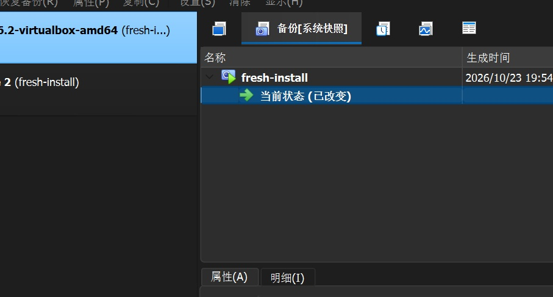

**Figure 2. Metasploitable 2 Fresh-Install Snapshot**

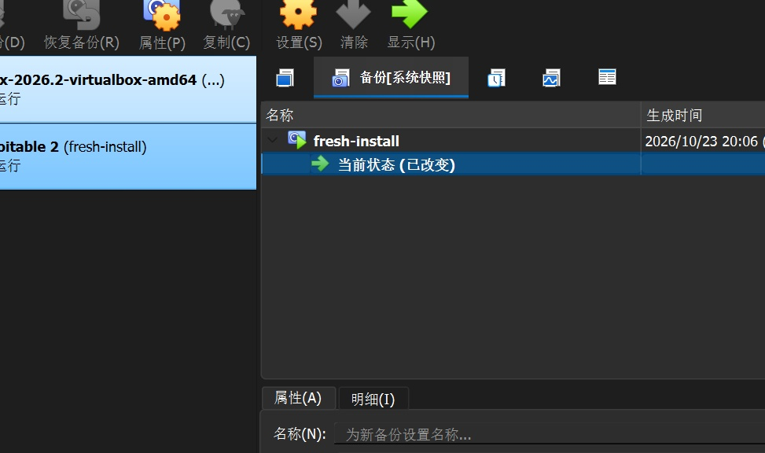

**Figure 3. Kali Linux Memory Configuration**

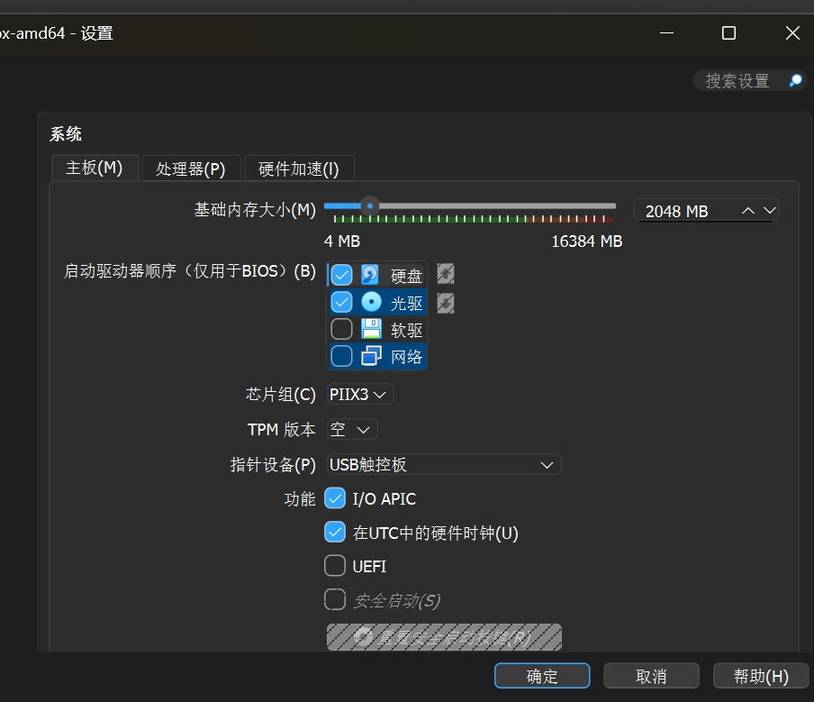

**Figure 4. Kali Linux Processor Configuration**

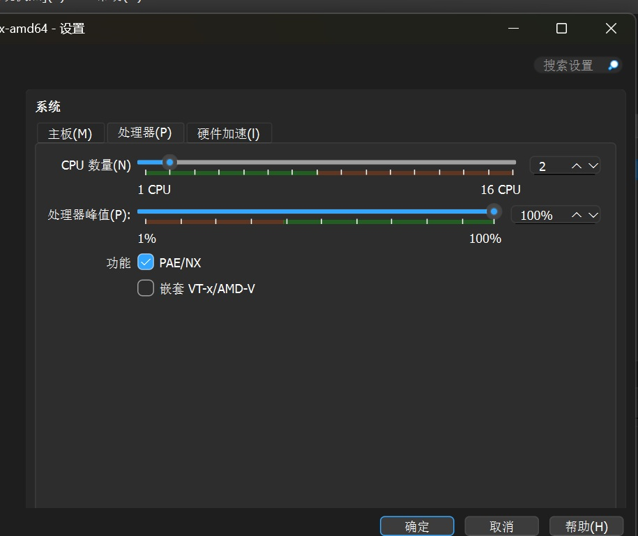

**Figure 5. Metasploitable 2 Memory Configuration**

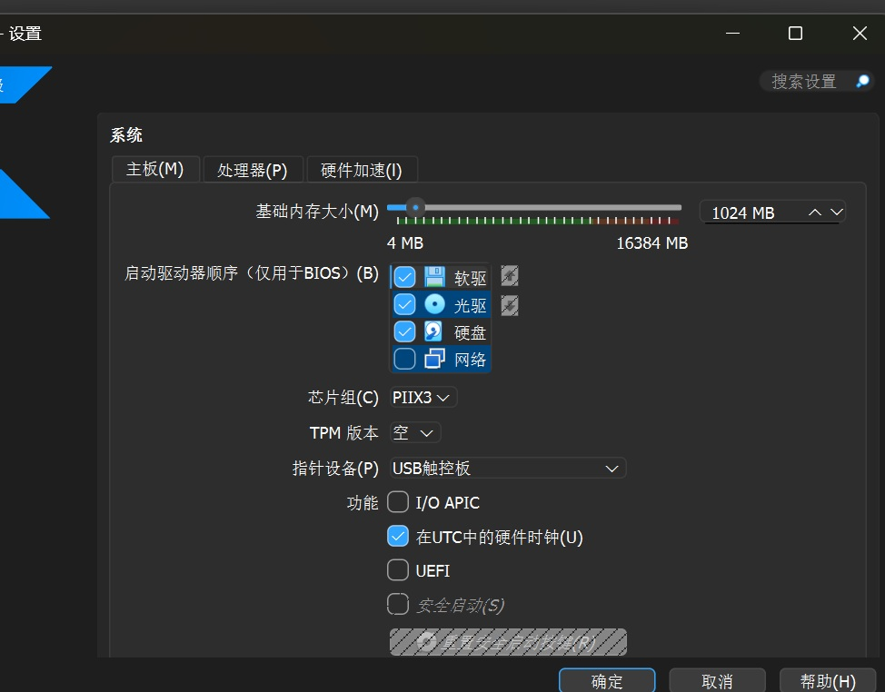

**Figure 6. Metasploitable 2 Processor Configuration**

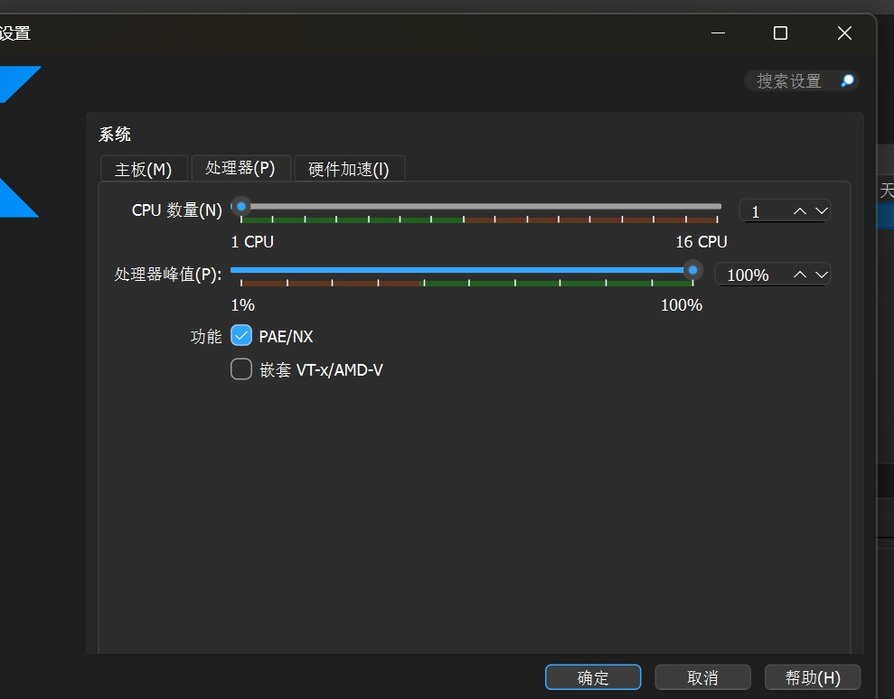

**Figure 7. Kali Linux Desktop**

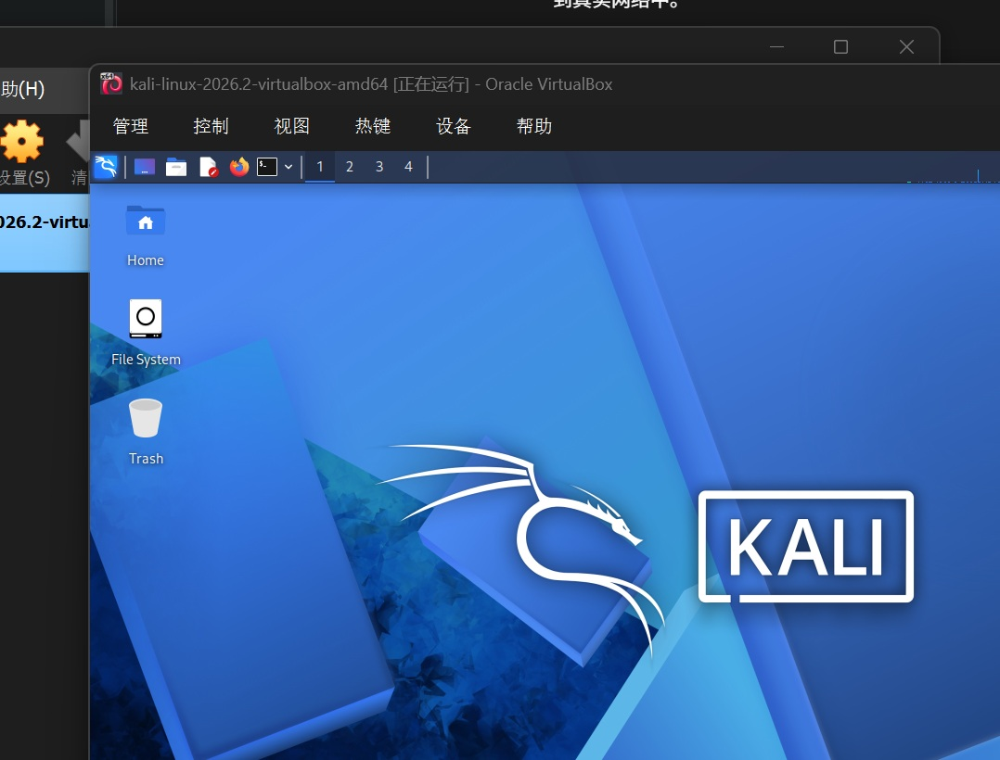

**Figure 8. Metasploitable 2 Login Prompt**

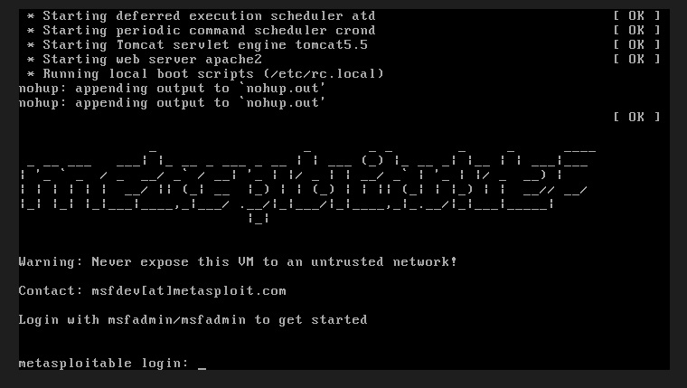

### 6.2 Network Reconnaissance

**Figure 9. Network Connectivity Verification**

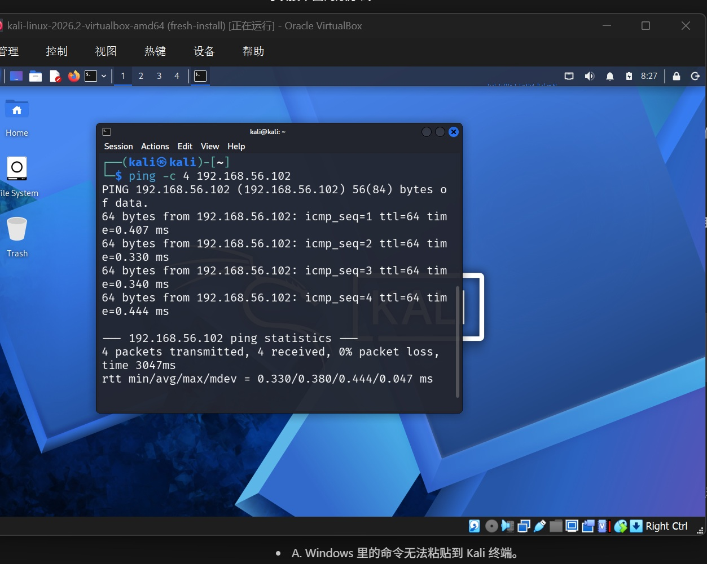

**Figure 10. Host Discovery**

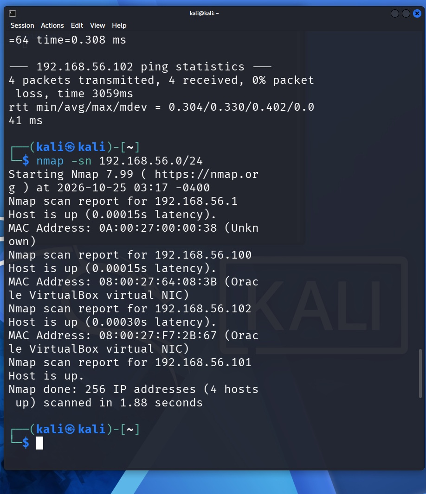

**Figure 11. TCP Port Scanning**

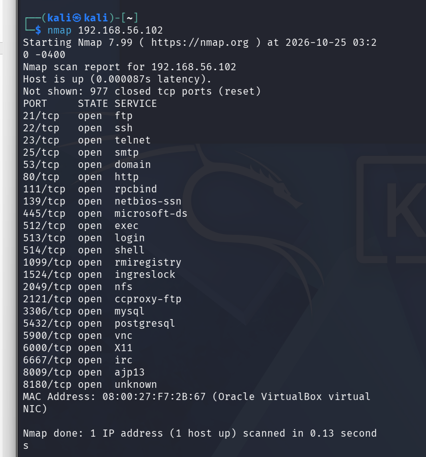

**Figure 12. Service and Version Detection**

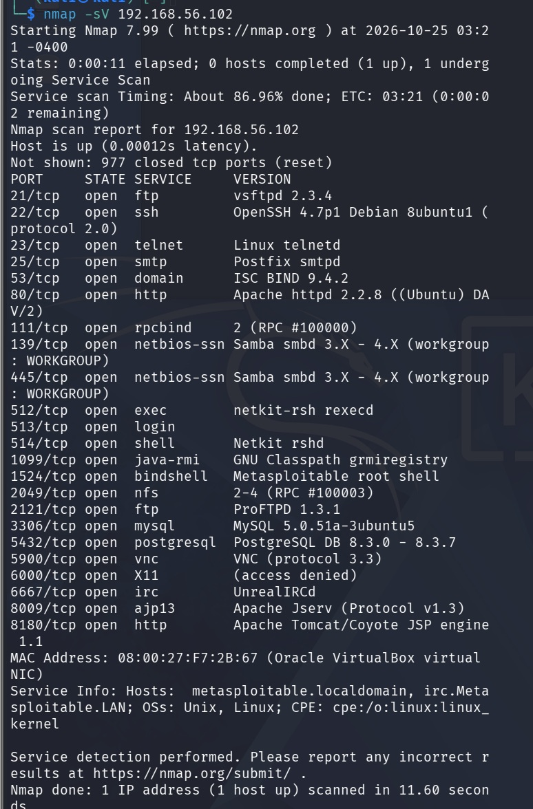

## 7. Limitations and Future Improvements

This project focuses on laboratory setup and reconnaissance. It does not include vulnerability exploitation, privilege escalation, or post-exploitation activities.

Future improvements could include:

- Performing more detailed analysis of identified services.
- Comparing scan results under different Nmap options.
- Investigating identified security issues in a controlled and authorised environment.
- Improving the documentation with additional analysis and reproducible commands.

## 8. Scope and Authorisation

All activities were performed in an isolated educational laboratory using the designated vulnerable target. No external systems or unauthorised networks were scanned.